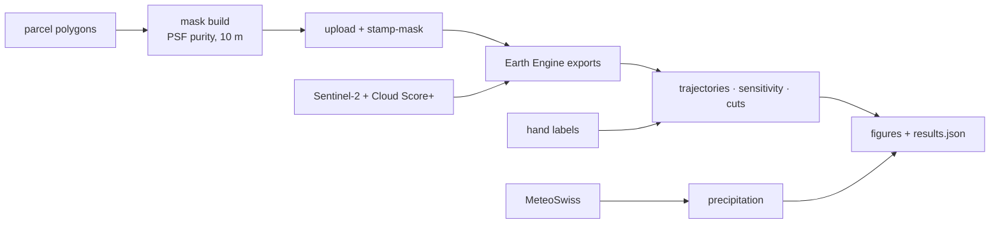

# Reading a drought from space

[](https://github.com/floew2/drought-from-space-switzerland/actions/workflows/ci.yml)


In summer 2026, Switzerland was hit hard by drought. At St. Gallen, rainfall to
mid-October reached only 61 % of the long-term median, the driest such period
in 31 years. Lake levels fell, meadows turned brown, and farmers reported fewer
grass cuts and shortages of winter feed. This project looks at the drought from
space, using free and open satellite data (Copernicus Sentinel-2, processed in
Google Earth Engine) together with open weather-station records. Its focus is
agricultural land, specifically grassland: how much the meadows suffered, when
the damage set in, and whether farmers stopped mowing earlier than usual.


*St. Galler Rheintal near Altstätten, Sentinel-2 true colour, 15 June – 31 July.
Left: median of 2019–2025. Right: 2026, same stretch. The meadows browned field
by field.*

**Data and method.** Sentinel-2 imagery at 10 m (2019–2026), cloud-masked with
Cloud Score+, is combined with the cantonal agricultural parcel map and daily
MeteoSwiss station data. Swiss meadows are small, so most 10 m pixels touch a
field edge and mix grass with roads, hedges or crops. Each pixel's purity is
therefore modelled from the sensor's point-spread function, a 10 m detector box
convolved with Gaussian optics (12.7 m wide at half maximum) derived from ESA's
MTF specification. Only pixels that draw at least 90 % of their signal from
inside a meadow are used. Their NDMI, an index sensitive to canopy water, is
tracked through each season and compared with 2019–2025. Mowing is detected per
field with a transparent rule set, validated against 143 hand-labelled
field-years. Details: [docs/METHOD.md](docs/METHOD.md).

**Scope**
- **Where:** Canton of St. Gallen, Switzerland: Linthebene and the St. Galler Rheintal.
- **When:** the 2026 growing season against 2019–2025; rainfall against 1991–2020.
- **What:** grassland condition (NDMI), mowing, rainfall and water balance.
- **Not covered:** yield in tonnes, crops other than grassland, forecasting.

## Results

| season NDMI integral, May–September | Linthebene | St. Galler Rheintal |
|---|---|---|
| intensive meadows | **−27 %** | **−23 %** |
| extensive meadows | **−29 %** | **−28 %** |
| rank among 2019–2026 | last of 8 | last of 8 |

- Spring was normal. The meadows collapsed through July, bottomed out in
  mid-August and recovered from early September.
- St. Gallen recorded 690 mm of rain by 12 October against a median of 1,135 mm.
  The water balance P − ET0 stood at −74 mm against a median of +494 mm.
- From the hand labels, the last cut of the season came a median 12 days earlier
  in 2026 (15 of 22 fields). On this sample that is an indication, not yet a
  significant result.


*Top left: cumulative rainfall at St. Gallen, 2026 against 1991–2020. Top right:
NDMI of intensive meadows at Linthebene, 2026 against 2019–2025. Bottom: one
meadow, two summers. Each sawtooth is a harvest; in 2026 the grass stops
regrowing after the July cut.*

More figures: [docs/gallery.md](docs/gallery.md). A step-by-step walkthrough:
[notebooks/walkthrough.ipynb](notebooks/walkthrough.ipynb).

## Quick start (synthetic data)

No account and no download needed:

```bash
git clone https://github.com/floew2/drought-from-space-switzerland.git
cd drought-from-space-switzerland
make install        # pip install -e ".[dev]"   (uv: uv sync --extra dev)
make demo           # whole pipeline on synthetic data, ~90 s -> output/synthetic/
```

The synthetic inputs have the same formats as the real ones and are calibrated
to the real headline numbers. The demo prints each synthetic number beside the
real one and fails if a target or a physical check is missed. Its figures go to
`output/synthetic/figures/` and are stamped SYNTHETIC.

## Running on real data

| step | needs | open? |
|---|---|---|
| rainfall and water balance | internet | **yes**, MeteoSwiss Open Data |
| grassland mask | parcel polygons per year | **partly**: the latest year is free from [geodienste.ch](https://www.geodienste.ch/); earlier years are not open. With one year, every field is kept. |
| grassland condition | the mask + an Earth Engine project | **yes**, free for noncommercial use |
| mowing scores | hand labels | **no**; make your own with the labelling widget |

The parcel data used here came from the Canton of St. Gallen and is not
redistributed. Nothing in `data/` is committed.



**Setup**

```bash
uv sync --extra dev --extra ee        # or: pip install -e ".[dev,ee]"
earthengine authenticate              # once; allow Drive access
```

Put your Earth Engine project in `config.local.yaml` (git-ignored):

```yaml
gee:
  project: <your-ee-project>
```

Exports go to your Google Drive and are downloaded from there: no Cloud Storage
bucket, no billing. Parcel shapefiles go to `data/nutzungen/<year>/`, hand
labels to `data/labels/`.

**Steps**

```bash
drought mask build                    # purity mask -> data/masks/grassland_mask_sg.tif
```

Upload the GeoTIFF once in the [Earth Engine Code Editor](https://code.earthengine.google.com/)
(Assets → New → GeoTIFF, name `grassland_mask_sg`, pyramiding **SAMPLE**), then:

```bash
drought ee stamp-mask                 # checks the asset against the local file
drought ee trajectory                 # site-mean index series
drought ee sensitivity                # purity-threshold sweep
drought ee cuts --labelled-only       # per-field series for the labelled fields
drought trajectory plot
drought sensitivity plot
drought precip --download
drought cuts score --site linthebene --labelled
drought cuts labels --site linthebene
drought results show                  # every headline number, refused if stale
```

Each `ee` command starts the export, waits, downloads and registers the file; an
interrupted one can simply be re-run. The trajectory export used about
25 EECU-hours of the free 150 a month. Every file carries a record of the
settings and mask that produced it, and loading refuses a mismatch.

To label mowing events yourself, in Jupyter:

```python
import drought as dr
df = dr.load_site("linthebene")
dr.labelling.label_widget(df, "linthebene", ev=dr.detect.detect_all(df), n=20)
```

All settings live in `config.yaml`; `drought --help` lists every command.

## Repository layout

```
config.yaml                  every setting
src/drought/                 the analysis: mask, trajectory, precip, detect, evaluate, provenance
src/drought/engine/          Earth Engine exports, run from Python
src/drought/synthetic/       synthetic stand-ins for every input
notebooks/walkthrough.ipynb  the pipeline step by step
docs/METHOD.md               how and why
docs/gallery.md              figures from the real data
tests/                       pytest; CI runs lint, tests, the demo and the notebook
```

## Data and licence

Code: MIT ([LICENSE](LICENSE)). Contains modified Copernicus Sentinel data
(2019–2026), processed in Google Earth Engine; Cloud Score+ (Pasquarella et al.
2023). Station data: MeteoSwiss Open Data (CC BY 4.0), *Quelle: MeteoSchweiz*.
Elevation: CGIAR-CSI SRTM 90 m. Field geometries: Nutzungsflächen, Kanton
St. Gallen, not redistributed.
