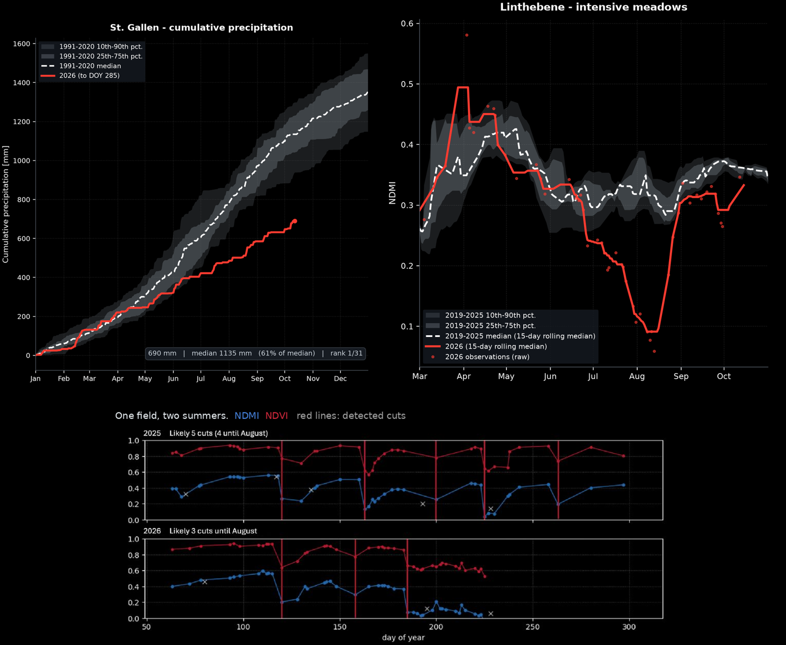
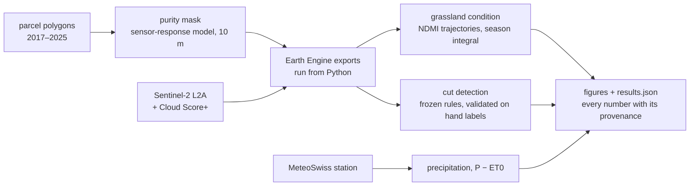

# Reading a drought from space

[](https://github.com/floew2/drought-from-space-switzerland/actions/workflows/ci.yml)


How hard did the 2026 summer drought hit grassland in the Canton of St. Gallen,
Switzerland? Sentinel-2 imagery and MeteoSwiss station data both say: **the
season's grassland moisture signal fell by roughly a quarter, and 2026 ranked
last of eight years at every site and for every management system.**


*St. Galler Rheintal near Altstätten, Sentinel-2 true colour at 10 m, 15 June –
31 July. Left: median of 2019–2025. Right: 2026. Same stretch on both, so the
browning is field by field, not a colour change of the image.*

## Results

| | Linthebene | St. Galler Rheintal |
|---|---|---|
| Season NDMI integral, intensive meadows | **−27 %** | **−23 %** |
| Season NDMI integral, extensive meadows | **−29 %** | **−28 %** |
| Rank among 2019–2026 | 1 of 8 | 1 of 8 |

- **When:** spring ran at or above normal. The index collapsed through July to
  0.09–0.15 in mid-August, then recovered sharply from early September.
- **Independent check:** St. Gallen recorded 690 mm of rain by 12 October, 61 %
  of the 1991–2020 median and the driest of 31 years. The climatic water balance
  P − ET0 stood at −74 mm, against a median of +494 mm.
- **Robust to the choices:** with the haze filter off, 2026 still ranks last
  everywhere. At every purity threshold from 0 to 0.95, its anomaly is negative
  at every site.
- **Mowing:** from the hand labels, fields stopped mowing a median 12 days
  earlier in 2026 (15 of 22 fields). On this sample that is an indication, not
  yet a significant result.

The comparison is 2026 against the 2019–2025 median, May to September
(DOY 121–273), on the days every year observed.



*Top left: cumulative precipitation at St. Gallen, 2026 against 1991–2020.
Top right: site-mean NDMI of intensive meadows at Linthebene, 2026 against
2019–2025. Bottom: one meadow, two summers. Each sawtooth is a harvest; in 2026
the canopy stops regrowing after the July cut. Real data, runs of
14 October 2026 (the single meadow: presentation, August 2026).*

## Read it, or run it

| if you want to… | go to |
|---|---|
| read the whole story as a website | **[floew2.github.io/drought-from-space-switzerland](https://floew2.github.io/drought-from-space-switzerland/)** |
| see the whole pipeline step by step, without installing anything | **[notebooks/walkthrough.ipynb](notebooks/walkthrough.ipynb)** (rendered on GitHub) |
| understand why each step is built the way it is | **[docs/METHOD.md](docs/METHOD.md)** |
| look at the figures | [docs/gallery.md](docs/gallery.md) |
| run it yourself, on synthetic data | the four lines below |
| run it on real data | [docs/WORKFLOW.md](docs/WORKFLOW.md) |

```bash
git clone https://github.com/floew2/drought-from-space-switzerland.git
cd drought-from-space-switzerland
make install        # pip install -e ".[dev]"   (uv: uv sync --extra dev)
make demo           # the whole pipeline on synthetic data, ~90 s -> output/synthetic/
```

**Synthetic data** needs no account and no download. It is generated
deterministically, calibrated to the real data's schemas, parcel shapes and
headline numbers, and every figure from it is stamped SYNTHETIC. The demo
prints each synthetic number beside the real one, marked *calibrated* or
*emergent*, and exits non-zero if a target or a physical invariant fails.

**Real data** is partly open. Precipitation reproduces exactly from MeteoSwiss
Open Data. The Sentinel-2 steps need a free (noncommercial) Earth Engine
project and parcel polygons. The most recent year of those is free from
[geodienste.ch](https://www.geodienste.ch/); the multi-year history used here
came from the Canton of St. Gallen and is not redistributed. The hand labels
are not published.
[WORKFLOW](docs/WORKFLOW.md#what-you-can-reproduce-without-my-data) says what
each step needs.

## How it works



## What this repository shows

The code is the smaller part. The judgement trail is in
[METHOD.md](docs/METHOD.md); in brief:

- **Which pixels to trust is derived, not assumed.** Most Swiss meadow cells
  touch a field edge. The Sentinel-2 response is modelled from ESA's MTF
  specified range (a detector box convolved with Gaussian optics). A cell's
  purity is the share of its response that comes from inside the field. Only
  cells with purity ≥ 0.90 are used. Sweeping that threshold shows that mixed
  pixels make the drought signal slightly *weaker*, never stronger.
- **Invariants catch bugs.** Because the response reaches past every boundary,
  the observed area at purity > 0 must exceed the polygon area. When it once
  fell below 1, that exposed a mask that had zeroed the halo. Fourteen bugs
  are documented with how each was found, and the code-level ones have a
  regression test that the old logic fails
  ([METHOD §6](docs/METHOD.md#6-bugs-found-by-checks)).
- **Machine-learning validation, without a learned model.** The cut detector is
  a transparent rule set, tuned on 42 hand-labelled field-years and then
  frozen. On 136 field-years it scores F1 0.868, and 0.897 without 2026. The
  synthetic data had predicted where it would fail in a drought year (the
  recovery looks like regrowth after a cut), and the real labels confirmed it:
  23 of 34 false positives in 2026. So the headline mowing result comes from
  the hand labels, not from the detector. A changepoint alternative was built
  and rejected on the same labels (F1 0.805).
- **Stale results cannot get through.** Every data file has a record of the
  settings and mask that produced it. Loading refuses a mismatch and names the
  setting that changed. The Earth Engine mask asset is checked cell by cell
  against the local file before any export runs.

## Commands

Everything runs through one command, `drought` (`drought --help`):

| | |
|---|---|
| `drought demo` | The whole pipeline on synthetic data, self-checking. |
| `drought notebook` | Re-runs the walkthrough notebook on synthetic data. |
| `drought --synthetic mask check` | Area cost of each purity threshold; the response-model comparison. |
| `drought --synthetic cuts score --site linthebene` | The frozen detector and the changepoint alternative against the labels. |
| `drought --synthetic cuts errors --site linthebene` | Where the detector errs, by year and by date. |
| `drought --synthetic cuts labels --site linthebene` | Last-cut shift from the hand labels alone. |
| `drought ee trajectory` / `sensitivity` / `cuts` | The Earth Engine exports, run from Python. |
| `drought results show` | Every headline number, refused if computed under other settings. |
| `make test` | The test suite: one regression test per real bug, the response-model derivation, CLI precedence and synthetic calibration. |

All settings live in `config.yaml`. Precedence, lowest to highest:
`config.yaml` < `--config FILE` < `--synthetic` < `--set KEY=VALUE`. For
example, `drought --synthetic --set mask.psf_model=gauss mask build` rebuilds
the mask with the older response model.

## Repository map

```
config.yaml                every setting, in one place
src/drought/               the analysis: mask, trajectory, precip, detect, evaluate, provenance
src/drought/engine/        the Earth Engine exports, run from Python
src/drought/synthetic/     calibrated stand-ins for every input; targets.py lists the real numbers
notebooks/walkthrough.ipynb  the pipeline step by step (synthetic run; numbers and tables included)
docs/METHOD.md             how and why
docs/WORKFLOW.md           running on real data
docs/gallery.md            figures: real results and the sensor model
site/                      website config (Jupyter Book -> GitHub Pages)
tests/                     pytest; CI runs lint, tests, the demo and the notebook
```

## Data and licence

Code: MIT ([LICENSE](LICENSE)). Contains modified Copernicus Sentinel data
(2019–2026), processed in Google Earth Engine. Station data: MeteoSwiss Open
Data (CC BY 4.0), *Quelle: MeteoSchweiz*. Field geometries and land-use codes:
Nutzungsflächen, Kanton St. Gallen, **not redistributed** in any form.
