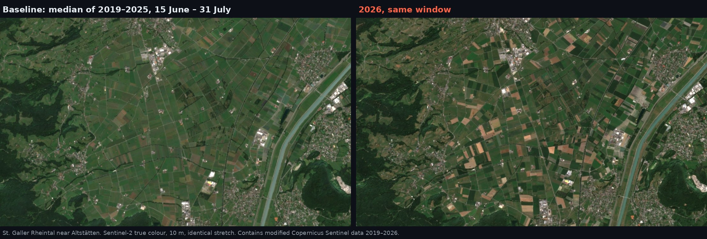
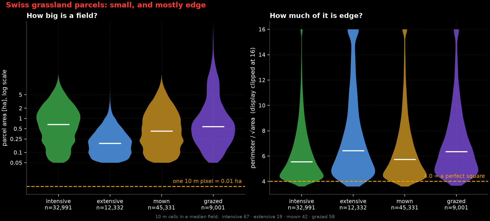
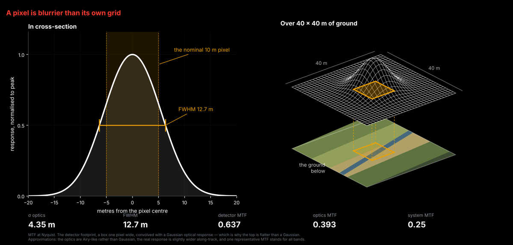
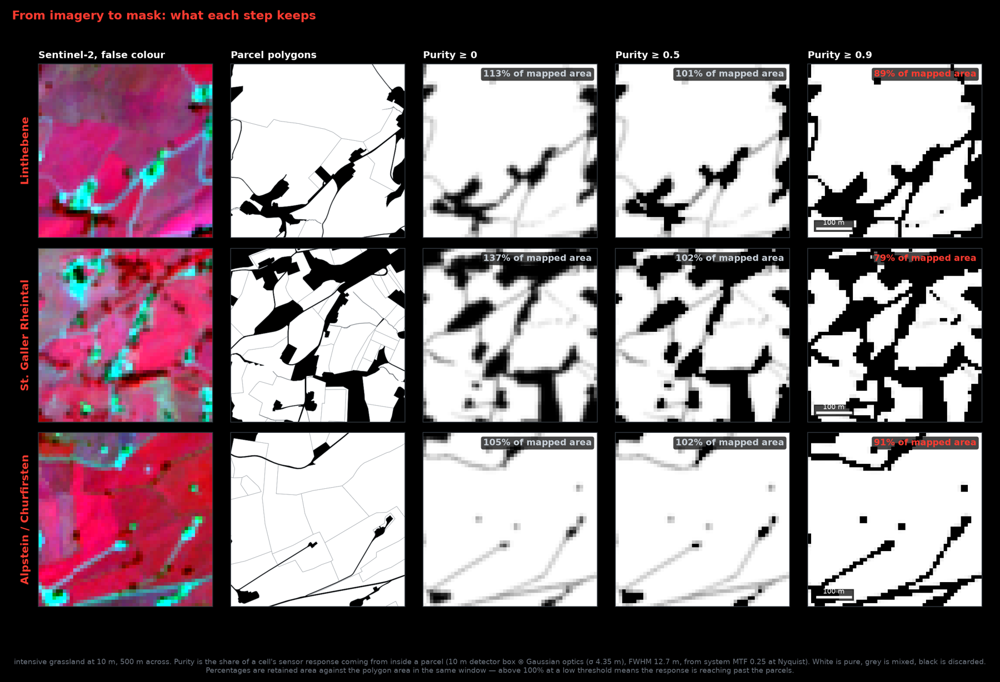
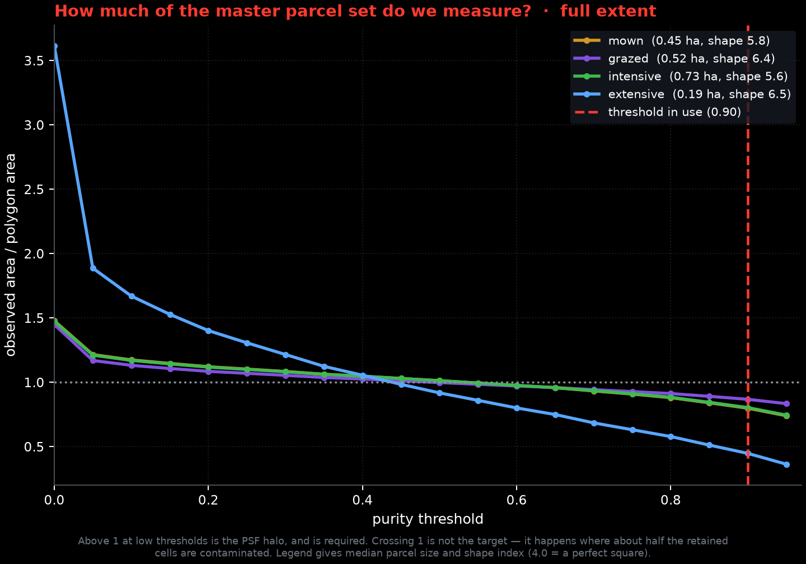
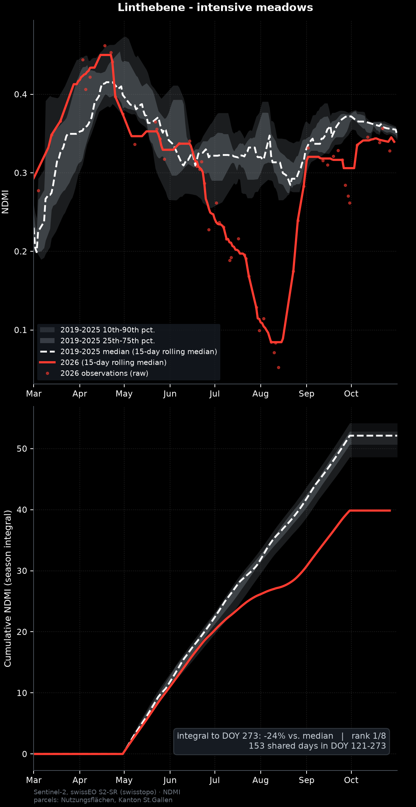
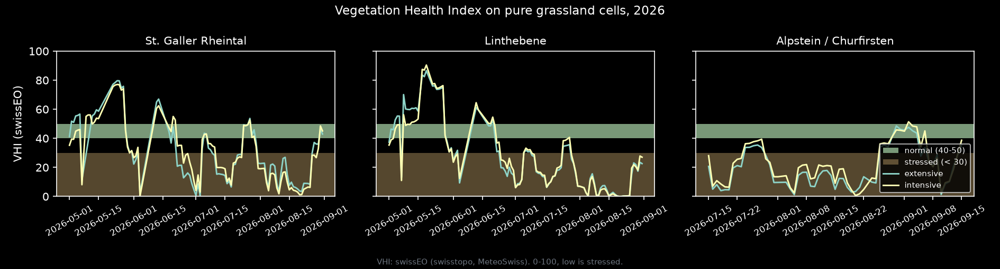
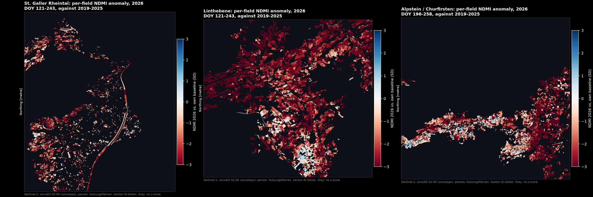
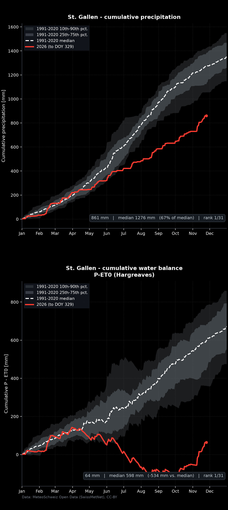
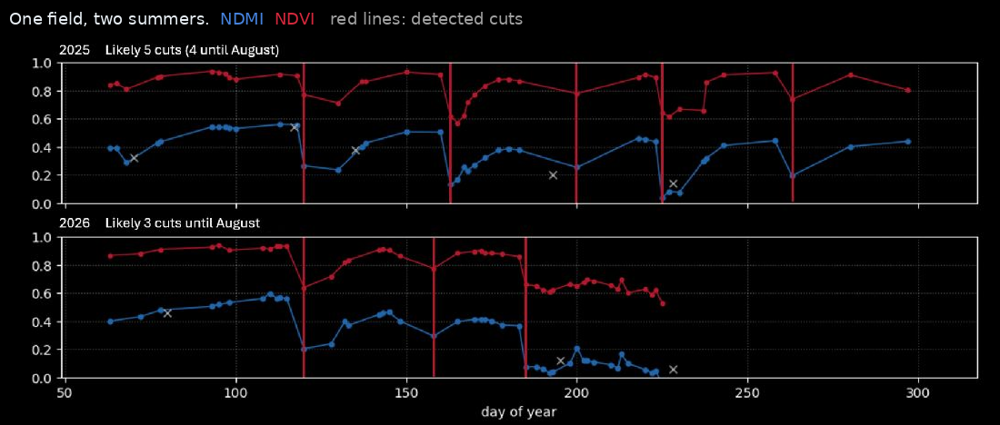

# Method

How the analysis works, and why it is built this way. For results at a glance
and how to run the code, see the [README](../README.md).

1. [Question and data](#1-question-and-data)
2. [The grassland mask](#2-the-grassland-mask)
3. [Grassland condition](#3-grassland-condition)
4. [Precipitation and water balance](#4-precipitation-and-water-balance)
5. [Cut detection](#5-cut-detection)
6. [Synthetic data](#6-synthetic-data)
7. [Limitations and open items](#7-limitations-and-open-items)

---

## 1. Question and data

How hard did the 2026 drought hit grassland in the Canton of St. Gallen, and
did farmers stop mowing earlier? Two valley-floor grassland areas are analysed,
Linthebene and the St. Galler Rheintal, plus the alpine summering area of
the Alpstein.

| input | what | used for |
|---|---|---|
| swissEO S2-SR v200 (swisstopo), Sentinel-2 surface reflectance, 10 m, 2019–2026 | spectral indices; cloud (OmniCloudMask), terrain-shadow and snow layers | condition, anomaly and cuts |
| Nutzungsflächen 2017–2025, Kanton St.Gallen (used with permission) | yearly field outlines with land-use codes | which pixels are grassland, of which kind |
| MeteoSwiss station St. Gallen, 1991–2026 | daily precipitation and temperature | independent check |
| swissEO VHI (swisstopo, MeteoSwiss), 2026 | Vegetation Health Index, 10 m, daily | independent check |

swissEO S2-SR is Sentinel-2 surface reflectance for Switzerland, co-registered,
reprojected to LV95 and mosaicked per satellite pass. Each mosaic is downloaded
once per site and computed locally (`drought fetch`, `drought run`). Run of
27 November 2026.

2026 is compared with 2019–2025. That baseline includes the 2022 drought, so
the 2026 anomaly is, if anything, understated. Everything is in CH1903+ / LV95
(EPSG:2056).



*Sentinel-2 true colour, 15 June – 31 July, identical stretch: the median of
2019–2025 (left) against 2026 (right). Meadows browned field by field.*

---

## 2. The grassland mask

Most Swiss meadows are small, so most 10 m pixels over them also see a road, a
hedge or a neighbouring crop. The mask answers one question per pixel: *how much
of what the sensor records here comes from inside one kind of grassland?*

### 2.1 Which fields: the master parcel set

A field is analysed only if it was grassland **of the same management type**
(intensive or extensive) in every year from 2017 to 2025. Outlines are redrawn,
split and merged between yearly deliveries, so fields are matched by **area
overlap** (≥ 80 %), not by ID or centroid. On the same parcels, centroid
matching kept 43 % of fields and overlap matching 86 %.

```
 66,843  grassland parcels ≥ 0.05 ha in 2025
  7,133  dropped: not grassland in every year
  5,378  dropped: changed management type
  2,418  exempt: summering code 930, present only in 2025
 54,332  remain (81.3 %), 83,662 ha
```

There is no size filter. Whether a field is large enough is decided by pixel
purity (§2.3), not by area. A compact 0.1 ha field can hold a clean pixel; a
0.3 ha strip cannot. Intensive and extensive meadows are never pooled: their
cutting regimes differ (4–6 cuts from early May against about 2, none before
15 June), and an average of the two belongs to neither.

### 2.2 Why purity matters: the fields are small and mostly edge



| category | parcels | median ha | < 0.5 ha | median shape index | 10 m pixels in a median field |
|---|---|---|---|---|---|
| intensive | 32,991 | 0.67 | 43 % | 5.56 | 67 |
| extensive | 12,332 | 0.19 | 85 % | 6.44 | 19 |

The shape index is perimeter / √area; 4 is a square. A median extensive meadow
holds 19 pixels, and with a shape index above 6 most of them lie within a pixel
or two of the edge. This is why the mask uses the native 10 m grid, not 20 m.

### 2.3 The sensor response

A pixel does not see a sharp 10 × 10 m square: it also draws signal from
around it. Purity is therefore defined on the sensor's **response**, not on
area. Parcels are rasterised at 2.5 m and convolved with the response; each
10 m cell gets the share of its signal from inside the right fields.



The model is a 10 m detector box convolved with Gaussian optics, derived from
the system MTF (modulation transfer function) at the Nyquist frequency:

| quantity | value | how |
|---|---|---|
| system MTF at Nyquist | 0.25 | chosen inside ESA's specified range, 0.15–0.30 for the 10 m bands ([ESA](https://sentinel.esa.int/web/sentinel/technical-guides/sentinel-2-msi/mission-performance)) |
| detector MTF | 0.637 | box one pixel wide: sinc(½) |
| optics MTF | 0.393 | 0.25 / 0.637 |
| σ of the Gaussian | 4.35 m | from MTF(f) = exp(−2π²σ²f²) |
| width of the response | 12.7 m (FWHM) | box ⊛ Gaussian, measured numerically |

A test checks that the code applies exactly this width. The model is
nadir-only and isotropic; real optics are not exactly Gaussian.

### 2.4 What the threshold costs

Only cells with purity ≥ 0.90 are used. That costs area, most of all for the
small extensive meadows:



*Intensive grassland at Linthebene, in the Rheintal and at Alpstein, 500 m
across. From left: Sentinel-2 false colour, the field outlines, and purity at
three thresholds (white pure, grey mixed, black discarded). The percentages are
retained area against field area: above 100 % at a low threshold, the response
reaches past the fields. Run of 17 October 2026.*



| category | observed / polygon area at purity > 0 | at ≥ 0.90 |
|---|---|---|
| intensive | 1.47 | 0.80 |
| extensive | 3.62 | 0.45 |

The ratio at purity > 0 **must exceed 1**, because the response reaches past
every field boundary. This check caught the worst bug of the project,
and the demo enforces it.

### 2.5 Is the threshold a lever on the answer?

The threshold is applied when the stored mosaics are read, so it can be swept. The 2026 NDMI
anomaly against 2019–2025, by threshold:

| | at 0.00 | at 0.90 (used) | at 0.95 | spread 0.50–0.95 |
|---|---|---|---|---|
| Linthebene intensive | −0.101 | −0.105 | −0.105 | 3.7 % |
| Linthebene extensive | −0.083 | −0.099 | −0.102 | 14.7 % |
| Rheintal intensive | −0.079 | −0.082 | −0.082 | 3.0 % |
| Rheintal extensive | −0.078 | −0.091 | −0.094 | 14.2 % |
| Alpstein intensive | −0.095 | −0.098 | −0.099 | 4.3 % |
| Alpstein extensive | −0.099 | −0.124 | −0.129 | 16.7 % |

The anomaly is negative at every threshold, and grows as the threshold
tightens: mixed pixels dilute the drought signal, most of all on small
extensive fields. At 0.90 it is within 0.5–3.9 % of the strictest value, so the
reported signal is slightly understated, never inflated, while going to 0.95
would cost about a fifth of the extensive pixels.

---

## 3. Grassland condition

### 3.1 Site-mean trajectories

For each site, management type and acquisition date, the pipeline takes the
mean index over pixels with purity ≥ 0.90. Before any curve is drawn:

- **Clouds, shadow, snow.** A pixel is used only if swissEO's cloud mask calls
  it clear (thin cloud is excluded too), it is not in cast terrain shadow or
  facing away from the sun, and it is not snow. A date is dropped if less than
  60 % of the site's grassland is clear, because a partly clouded scene samples
  *different fields*, not a random subset.
- **One mosaic per pass.** swissEO merges the tiles of a satellite pass, so no
  ground is counted twice on the same day.
- **Residual haze.** Thin haze passes the cloud mask, but depresses red-band
  NDVI far more than SWIR-based NDMI. Dates where NDVI drops while NDMI does not
  are flagged with robust z-scores (15–17 % of dates, evenly across years).

### 3.2 The season integral

The headline is the area under the NDMI curve from 1 May to 30 September
(day of year, DOY, 121–273), relative to the 2019–2025 median. Every year is integrated over
exactly the days **all** remaining years observed (105–153 of 153), so a
cloudier year is not penalised for missing data. Gaps longer than 30 days are
left empty rather than interpolated. A baseline year with less than 70 % of the
window covered is dropped; with fewer than five baseline years left, the rank
is flagged as weak.

### 3.3 Why NDMI

NDMI (near-infrared against shortwave infrared) responds to canopy water and,
unlike NDVI, does not saturate over dense meadow. It has no absolute scale, so
it is only read against each site's own history.

### 3.4 Result



| season NDMI integral (baseline years) | Linthebene | St. Galler Rheintal | Alpstein |
|---|---|---|---|
| intensive meadows | −24 % (7) | −24 % (6) | −19 % (4) |
| extensive meadows | −25 % (7) | −22 % (4) | −24 % (4) |

2026 was the lowest of the eight years in all six series. Spring ran at or
above normal; at Linthebene the index collapsed through July to below 0.1 in
mid-August and recovered sharply from early September. Both management types
agree, so mowing is not the explanation. Where only four baseline years remain
(cloudy summers in the Rheintal and on the Alpstein), the rank rests on a weak
envelope.

**Robustness.** With the stricter coverage rule of 80 %, fewer baseline years
survive and Alpstein extensive drops out, but the integrals stay between −22 %
and −30 % and 2026 still ranks last everywhere. Counting thin cloud as clear
keeps more years and moves the integrals by at most three points.



**Cross-check.** swisstopo's Vegetation Health Index (VHI, with MeteoSwiss)
combines NDVI with land-surface temperature, each scaled against 1991–2020. On
the same pure cells it sat mostly in the stressed range (below 30) from July to
late August in both valleys and began to rise only at the end of August: an
independent source showing the same timing.

### 3.5 Per-field anomaly maps



For each parcel, NDMI is averaged over its pure cells (purity ≥ 0.90) on every
mosaic where at least half of them are clear, then over the year's window
(DOY 121–243, May–August; at Alpstein, after snowmelt, DOY 196–258, mid-July to
mid-September). 2026 is then a z-score against the parcel's own baseline years:
their median and standard deviation, with at least four years.

---

## 4. Precipitation and water balance



The current year and the 1991–2020 reference come from the same station
series, aligned by calendar day, so a difference cannot come from a change of
instrument. To 25 November 2026: **861 mm against a median of 1,276 mm**, 67 %
and the driest of 31 years.

Rain alone understates a hot drought, so the second panel shows the climatic
water balance P − ET0 (Hargreaves): **+64 mm against a median of +598 mm**.
It fell below zero in July and stayed there until a wet November.
This is atmospheric supply against demand, not soil moisture.

---

## 5. Cut detection

### 5.1 Why per field

A site mean averages hundreds of fields cut on different days, which smooths the
mowing sawtooth away. So cuts are detected per field, on a sample of fields of
at least 0.5 ha, each shrunk inward by 15 m.



### 5.2 The rules

A cut is a sudden drop in NDMI, confirmed by NDVI:

| rule | why |
|---|---|
| drop ≥ 0.20 and ≥ 35 % of the season's range | a real fall, not noise |
| drop rate ≥ 0.010 per day | mowing is a step; drought decline is a slope |
| NDVI falls too | a real cut removes biomass |
| still low at the next observation within 12 days | cut grass stays short; an instant rebound is atmosphere |
| a later observation within 20 days | an event at the very end cannot be verified |
| a trough followed by steep regrowth also counts | catches a cut hidden in a data gap |
| events closer than 21 days merge | the agronomic minimum between cuts |

The cut series use the same cloud rule as the condition series, and skip
mosaics where more than 80 % of the site's grassland is unusable.

### 5.3 Validation

The rules were tuned on 42 hand-labelled field-years and then **frozen**. Labels
were made in a purpose-built widget that hides the detector's proposals while
labelling. The label set has since grown to 143 field-years at Linthebene
without any change to the rules, so the later labels are a true hold-out. Each
detection is matched one-to-one to a label within 12 days.

| | precision | recall | F1 |
|---|---|---|---|
| all 136 scorable field-years | 0.837 | 0.809 | **0.823** |
| without 2026 | 0.905 | 0.782 | 0.839 |
| 2026 only | 0.646 | 0.939 | 0.765 |

The rules were tuned on Earth Engine series (Cloud Score+ cloud mask) and
scored F1 0.87 there; on swissEO they are unchanged. Of the 73 missed cuts,
30 are the last cut of a season.

The labels are read off the same curves the detector uses, so this measures
agreement with an expert reading of the signal, not with a farm diary.

### 5.4 The rejected alternative

A penalised changepoint fit was built as the principled alternative and scored
on the same labels. It over-segments and reaches F1 0.788, so it was rejected.
It stays in the code (`changepoint.py`). With 143 labelled field-years from one
site, a transparent, frozen rule set is more defensible than a learned model.

### 5.5 Which cut metric can compare years

Cut **counts** are not comparable: sunny drought summers give more clear images,
and more images reveal more cuts. The **last cut of the season** is the robust
metric. Each field is compared with its own earlier years, which removes site
and farm effects.

### 5.6 The drought recovery fools the detector

On synthetic data, the frozen rules showed a weak spot: a deep drought trough
and steep recovery look just like a cut and regrowth. The real labels
confirm it: 22 of the detector's 34 false cuts in 2026 fall between DOY 220
and 260, the trough and the recovery.

| DOY | 180–200 | 200–220 | 220–240 | 240–260 | 260–280 |
|---|---|---|---|---|---|
| 2026 false positives | 2 | 5 | **17** | 5 | 5 |

So the last-cut comparison ends at DOY 228 (mid-August) for every year, and it
is computed **from the hand labels alone**. 22 fields are labelled both in 2026
and in at least one earlier year:

- the last cut came a median **11.9 days earlier** in 2026;
- 15 of the 22 fields stopped sooner.

Most fields have only one earlier year, and a sign test gives p ≈ 0.13: the
direction agrees with the drought, but the result is not yet significant.

### 5.7 Elevation

Cutting frequency falls with altitude, so every field carries its elevation
(SRTM 90 m) and cut counts are never pooled across altitude.

---

## 6. Synthetic data

The real parcel data cannot be published, so `drought.synthetic` generates
stand-ins with the same files and schemas: yearly cadastres with redrawn, split
and merged outlines; index series with clouds, haze, mowing and drought;
hand labels; and a MeteoSwiss-format station series. The generator is
calibrated so that the same code reproduces the real headline numbers. Matching
a calibrated number shows only that the pipeline is wired correctly. The area
ratios, which were not targeted, land close to the real ones.

What synthetic data cannot do is show that the drought happened.

---

## 7. Limitations and open items

- **The MTF value.** ESA specifies 0.15–0.30; 0.25 is assumed. Rebuilding the
  synthetic mask at 0.15 and 0.30 (`--set mask.psf_mtf_nyquist=…`) would show
  what the choice costs.
- **Mowing sample.** The last-cut result rests on 22 fields at one site, most
  with one baseline year. More baseline labels for the same fields would
  strengthen it most cheaply. The detector has not been validated outside
  Linthebene.
- **Thin cloud.** Counting swissEO's thin-cloud class as clear would keep more
  dates, but its effect on the cut detector is untested, so it is excluded.
- **NDMI is a proxy.** It tracks canopy water and density, not yield. The
  integral is a relative measure against each site's own history.
