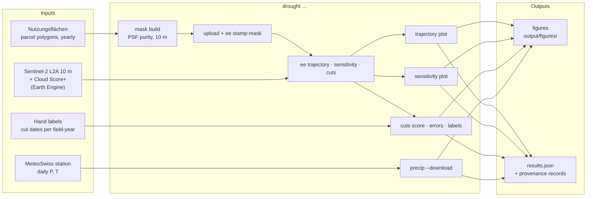

# Workflow — running on real data

The [README](../README.md) runs everything on synthetic data, with nothing to
install beyond the package. This page is for running the pipeline on real
inputs. [METHOD.md](METHOD.md) explains why each step is built the way it is.

## The pipeline at a glance



| setting | value | where |
|---|---|---|
| mask grid | 10 m, LV95 (EPSG:2056) | `mask:` |
| sensor response | detector box ⊛ Gaussian, FWHM 12.7 m (system MTF 0.25 at Nyquist) | `mask.psf_model` |
| pixel purity used | ≥ 0.90 | `mask.purity_min` |
| cloud mask | Cloud Score+ ≥ 0.60 (0.50 for cuts) | `gee.clear_threshold` |
| comparison | 2026 against 2019–2025; season integral DOY 121–273 | `project:`, `analysis:` |
| precipitation reference | 1991–2020, station St. Gallen | `precip:` |

Every setting lives in `config.yaml`. Change it there, never in code or in a
notebook, so every figure can be traced to what produced it.

## What you can reproduce without my data

| step | needs | can you reproduce it? |
|---|---|---|
| synthetic demo, walkthrough notebook | nothing | **yes, exactly** |
| precipitation and water balance | internet (MeteoSwiss Open Data) | **yes, exactly** |
| grassland mask | parcel polygons | **partly.** The most recent year is free from [geodienste.ch](https://www.geodienste.ch/) ("Landwirtschaftliche Bewirtschaftung: Nutzungsflächen"). Earlier years are not openly available. With one year the persistence rule has nothing to compare and keeps every field, so your mask is less strict than mine. |
| grassland trajectories, threshold sweep | the mask + an Earth Engine project (free for noncommercial use) | **yes, close.** Results differ by the mask difference above. |
| cut detection | the mask + Earth Engine quota | runs; the full sample exceeds the free monthly quota |
| detector scores, last-cut shift | hand labels | **no.** The labels are not published. You can make your own with the labelling widget (below). |

The parcel data I used came from the Canton of St. Gallen and is not
redistributed, in any form. Nothing in `data/` is ever committed.

## 1. Setup

```bash
uv sync --extra dev --extra ee        # or: pip install -e ".[dev,ee]"
earthengine authenticate              # once; allow Drive access when asked
```

Put your Earth Engine project in `config.local.yaml` (git-ignored; it may hold
nothing else):

```yaml
gee:
  project: <your-ee-project>
```

Exports go to your Google Drive and are downloaded from there. No Cloud
Storage bucket, no billing. If Drive refuses, enable the Google Drive API in
your project (free).

Put the inputs where `config.yaml` expects them ([data/README.md](https://github.com/floew2/drought-from-space-switzerland/blob/main/data/README.md)):

```
data/nutzungen/<year>/…shp     parcel polygons, one folder per year
data/labels/                    hand labels (optional)
```

## 2. Mask

```bash
drought mask build
drought mask check                    # area cost per threshold; the area invariant
```

Upload `data/masks/grassland_mask_sg.tif` once in the
[Code Editor](https://code.earthengine.google.com/): Assets → NEW → GeoTIFF,
name `grassland_mask_sg`, pyramiding policy **SAMPLE**. Then:

```bash
drought ee stamp-mask                 # compares 400 cells with the local file, then stamps it
```

Every export refuses to start unless the asset carries the local mask's hash.

## 3. Earth Engine exports

```bash
drought ee trajectory --smoke         # small run first: read the EECU cost
drought ee trajectory
drought ee sensitivity
drought ee cuts --labelled-only       # only the labelled field-years (cheap)
```

Each command starts the tasks, waits, downloads and registers the files. An
interrupted command can simply be run again. **Cost:** the trajectory export
used about 25 EECU-hours, the sensitivity sweep about 5. A full cut extraction
(`drought ee cuts`) would need around a million EECU-seconds, several times the
Community tier's 150 EECU-hours a month.

## 4. Analysis

```bash
drought trajectory plot
drought sensitivity plot
drought precip --download
drought cuts score  --site linthebene --labelled
drought cuts errors --site linthebene --labelled
drought cuts labels --site linthebene
drought results show                  # every headline number, refused if stale
```

Or set `REAL = True` in `notebooks/walkthrough.ipynb` and run it. **Never commit
a notebook run on real data**: it would contain parcel IDs and figures from data
that cannot be published. A test refuses it.

**Labelling** (in Jupyter):

```python
import drought as dr
df = dr.load_site("linthebene", labelled=False)
ev = dr.detect.detect_all(df)
dr.labelling.label_widget(df, "linthebene", ev=ev, n=20, seed=0)
```

The widget hides the detector's cuts while you label, then reveals them.

## 5. Why stale results cannot get through

- **Provenance records.** Every file gets a record of the settings and mask that
  produced it. Analysis steps refuse a file whose record does not match the
  current configuration, and name the setting that changed.
- **Hashed export names.** Exports carry `_cfg<hash>` of every Earth Engine
  setting plus the mask.
- **Stamped mask asset.** See step 2.

The two interactive Code Editor scripts in `gee/` (a grassland map and
Sentinel-2 hotspots) are for looking, not for data. `drought gee render`
writes `config.yaml`'s settings into them, and CI fails if they drift.

## Data sources

Copernicus Sentinel-2 MSI Level-2A (harmonized): contains modified Copernicus
Sentinel data 2019–2026, processed in Google Earth Engine. Cloud Score+
(Pasquarella et al. 2023, CVPRW, doi:10.1109/CVPRW59228.2023.00206). Elevation:
CGIAR-CSI SRTM 90 m v4. Land cover for the interactive maps: ESA WorldCover
v200, Google Dynamic World V1. Parcels: Nutzungsflächen, Kanton St. Gallen,
2017–2025 (not redistributed). Station data: MeteoSchweiz Open Data,
SwissMetNet St. Gallen, daily values, CC BY 4.0, *Quelle: MeteoSchweiz*.
