# Gallery

The figures, rendered, so the results can be read without cloning. All of them
come from the real data, except the sensor-response model, which uses no data
at all. Most are aggregates (curves, distributions, totals) and imagery; the
mask overview, the per-field anomaly maps and one meadow's mowing curve show
individual fields. The parcel data comes from the Canton of St. Gallen, is used
with its permission and is not published.

Synthetic figures are never committed. `make demo` writes them to
`output/synthetic/figures/` for anyone who wants to see what each step does.
The real figures are copied in by hand from a real run
([rules](https://github.com/floew2/drought-from-space-switzerland/blob/main/docs/figures/real/README.md)).

---

## What it looked like

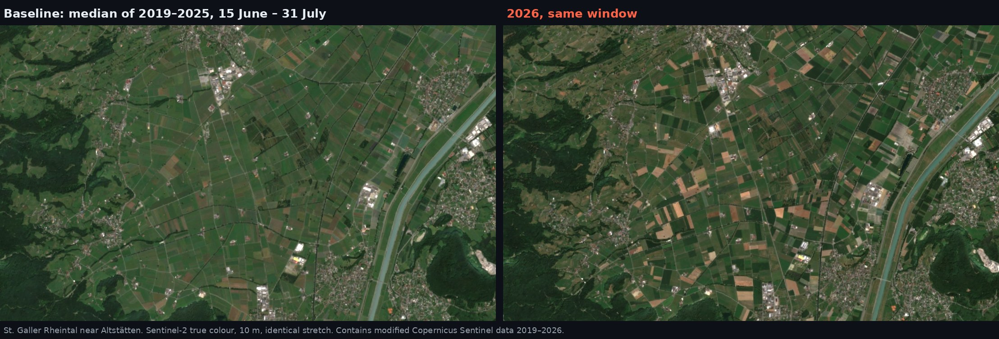

Sentinel-2 true colour, 10 m, 15 June – 31 July: the 2019–2025 median against
2026, with an identical stretch. Made in the Earth Engine Code Editor for the
August 2026 presentation. Imagery only; no parcel data.

## From imagery to mask

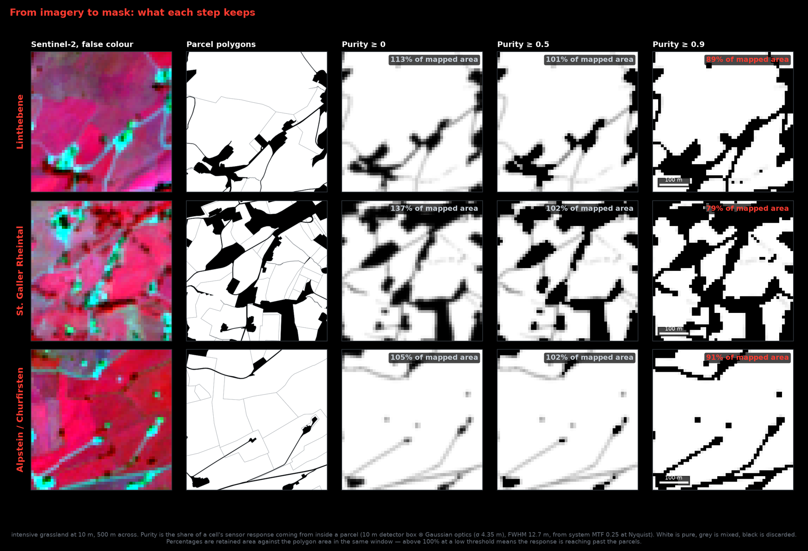

Intensive grassland at Linthebene, in the Rheintal and at Alpstein, 500 m
across. From left: Sentinel-2 false colour, the field outlines, and purity at
three thresholds (white pure, grey mixed, black discarded). The percentages are
retained area against field area: above 100 % at a low threshold, the response
reaches past the fields. Current mask, run of 17 October 2026 (`drought mask
overview`); the false colour is from that run's Earth Engine composite.
[METHOD §2.4](METHOD.md#24-what-the-threshold-costs).

## Grassland condition, season NDMI against 2019–2025

swissEO S2-SR v200, run of 27 November 2026. Mask built with the box ⊛ Gaussian
response model and no size filter ([METHOD §2](METHOD.md#2-the-grassland-mask));
integrals over DOY 121–273.

| | intensive meadows | extensive meadows |
|---|---|---|
| **Linthebene** | 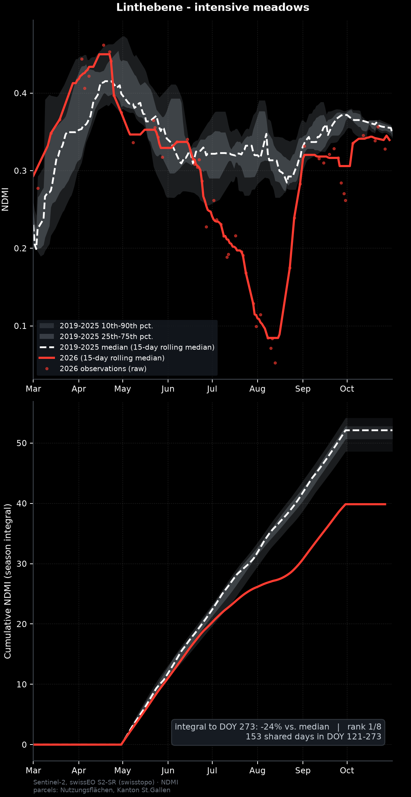 −24 %, rank 1 of 8 | 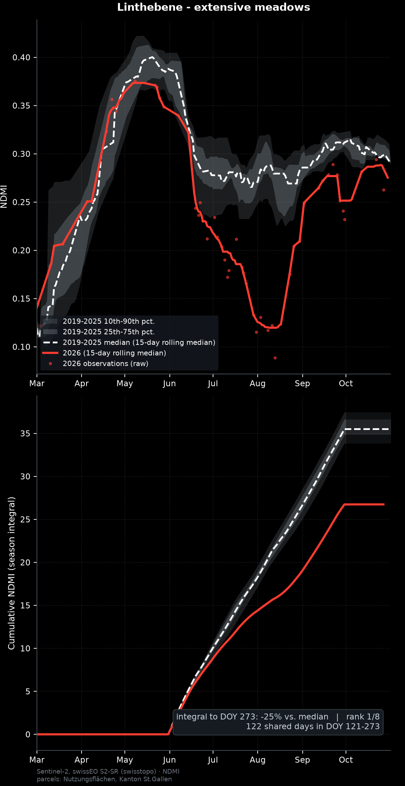 −25 %, rank 1 of 8 |
| **St. Galler Rheintal** | 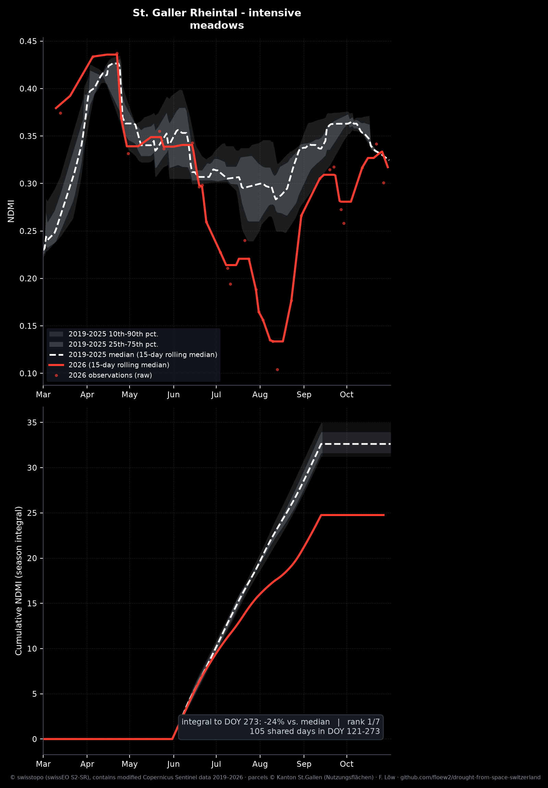 −24 %, rank 1 of 7 | 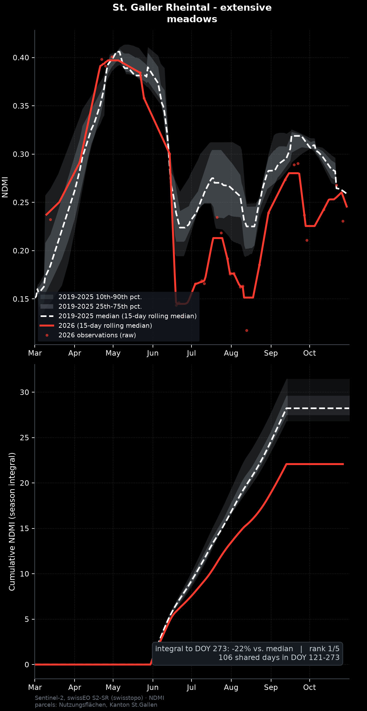 −22 %, rank 1 of 5 |
| **Alpstein** | 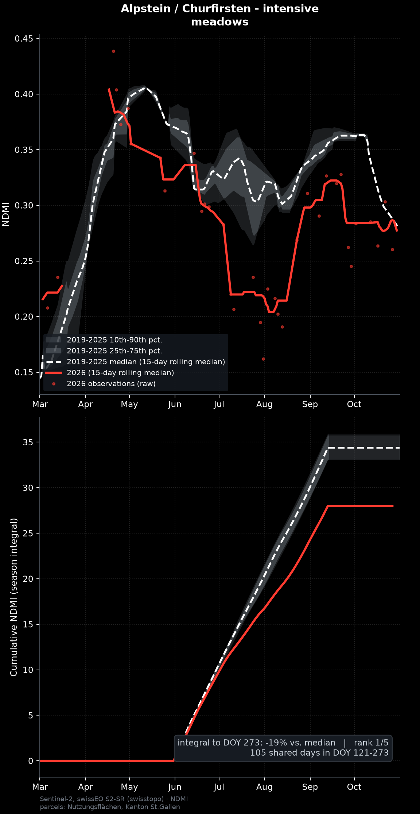 −19 %, rank 1 of 5 | 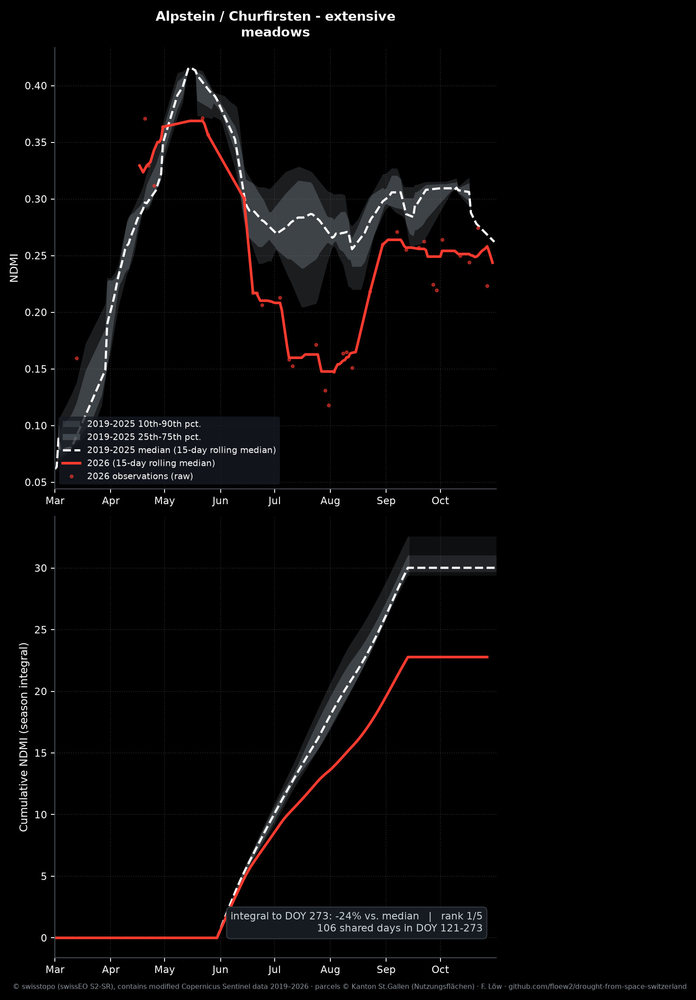 −24 %, rank 1 of 5 |

Top panel: site-mean NDMI, with the 2019–2025 envelope and median, 2026 in red,
and the raw 2026 observations as dots. Bottom panel: the season integral over
the days every year observed. Where a rank is out of fewer than 8, cloudy
baseline years were dropped. [METHOD §3](METHOD.md#3-grassland-condition).

## Per-field anomaly

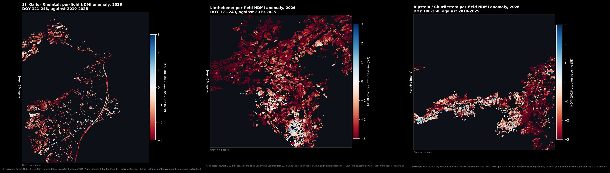

Each parcel's 2026 NDMI against its own 2019–2025 median, in standard
deviations; red is drier than usual. Window May–August; at Alpstein, mid-July
to mid-September. [METHOD §3.5](METHOD.md#35-per-field-anomaly-maps).

## Cross-check: Vegetation Health Index

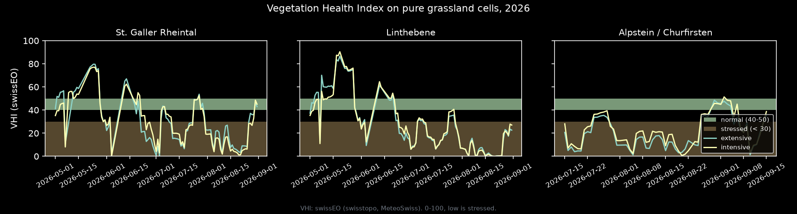

swisstopo's VHI (with MeteoSwiss), on the same pure grassland cells. Below 30
is stressed. [METHOD §3.4](METHOD.md#34-result).

## You can watch the mowing stop

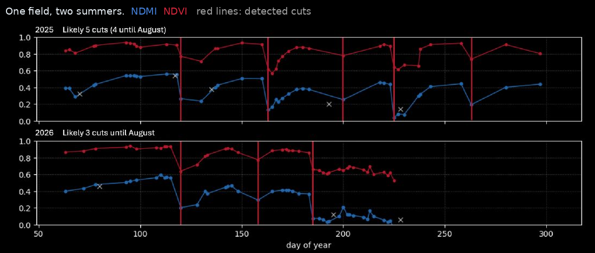

One meadow, two summers. Each sawtooth is a harvest: the grass is cut, the
index drops, then it regrows. In 2025 there are five cuts; in 2026, three, and
after the July cut the canopy no longer recovers. From the August 2026
presentation. [METHOD §5](METHOD.md#5-cut-detection).

## Precipitation and water balance, St. Gallen

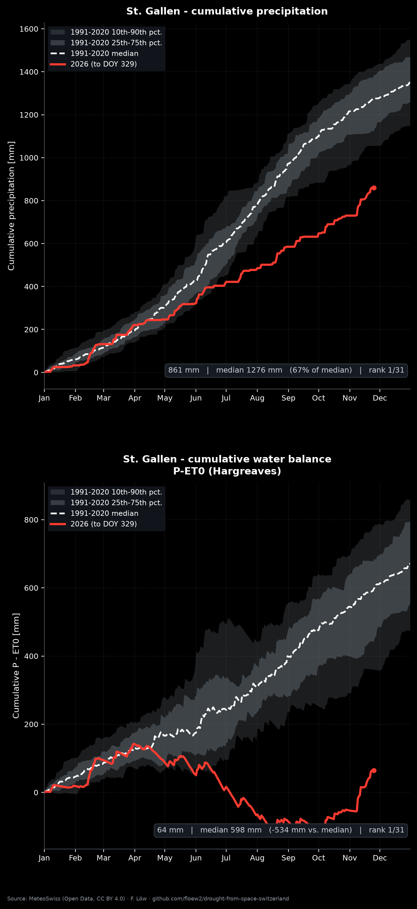

861 mm to 25 November, 67 % of the 1991–2020 median, the driest of 31 years.
P − ET0 (Hargreaves) stood at +64 mm, against a median of +598 mm.
Source: MeteoSwiss. [METHOD §4](METHOD.md#4-precipitation-and-water-balance).

## Field size and shape, and what the purity threshold costs

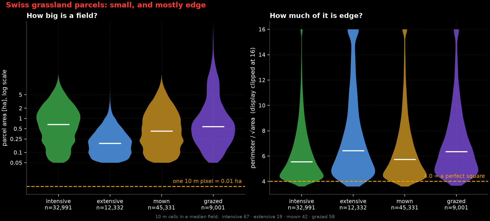

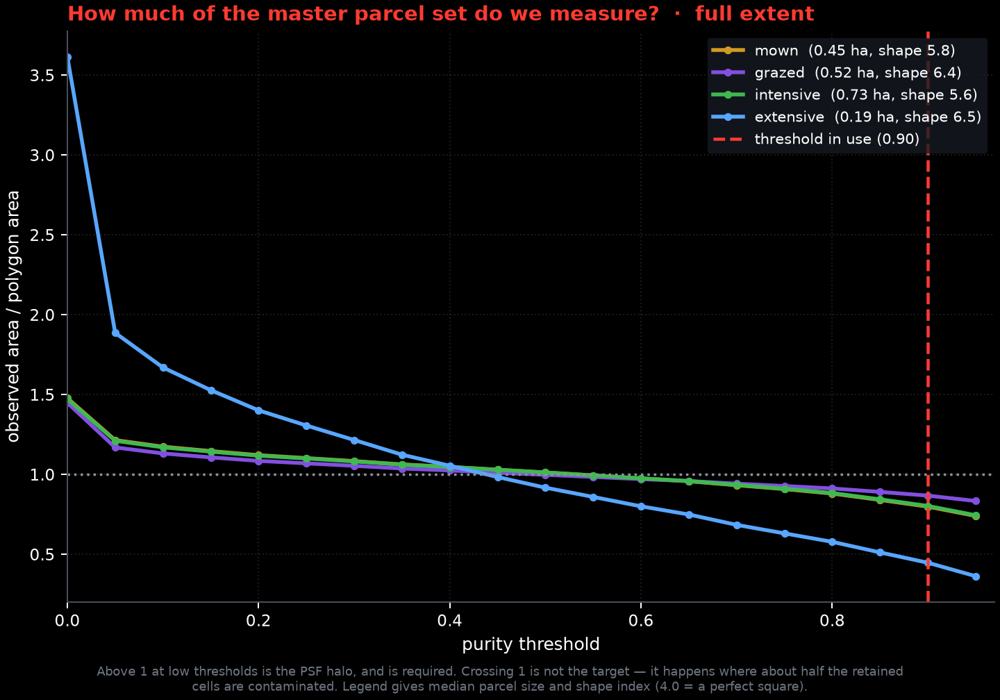

Distributions and totals over the master parcel set. No geometry is shown.
[METHOD §2.2](METHOD.md#22-why-purity-matters-the-fields-are-small-and-mostly-edge),
[§2.4](METHOD.md#24-what-the-threshold-costs).

## The sensor response (model)

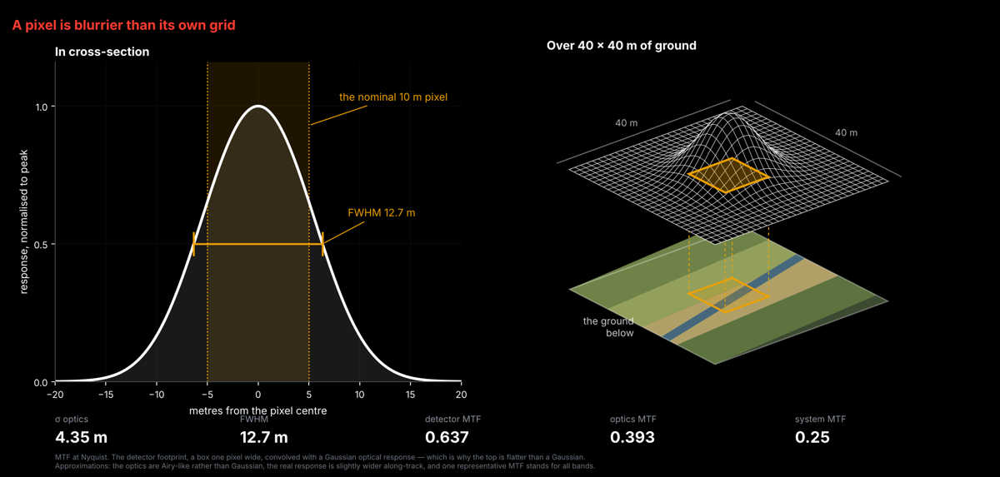

The response the purity mask is built on: a 10 m detector box convolved with
Gaussian optics (σ 4.35 m), from the system MTF.
[METHOD §2.3](METHOD.md#23-the-sensor-response).
