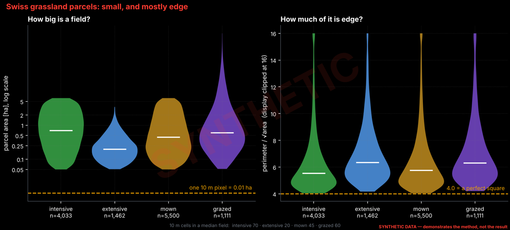
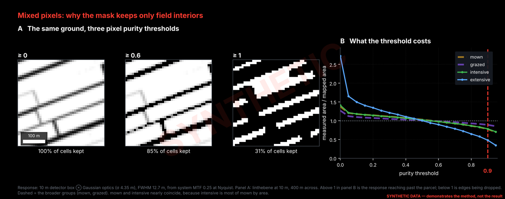
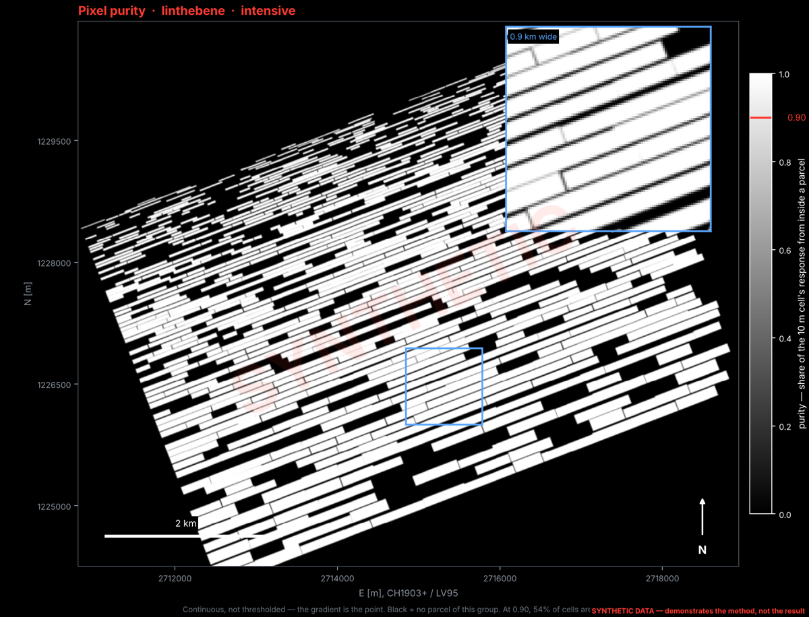
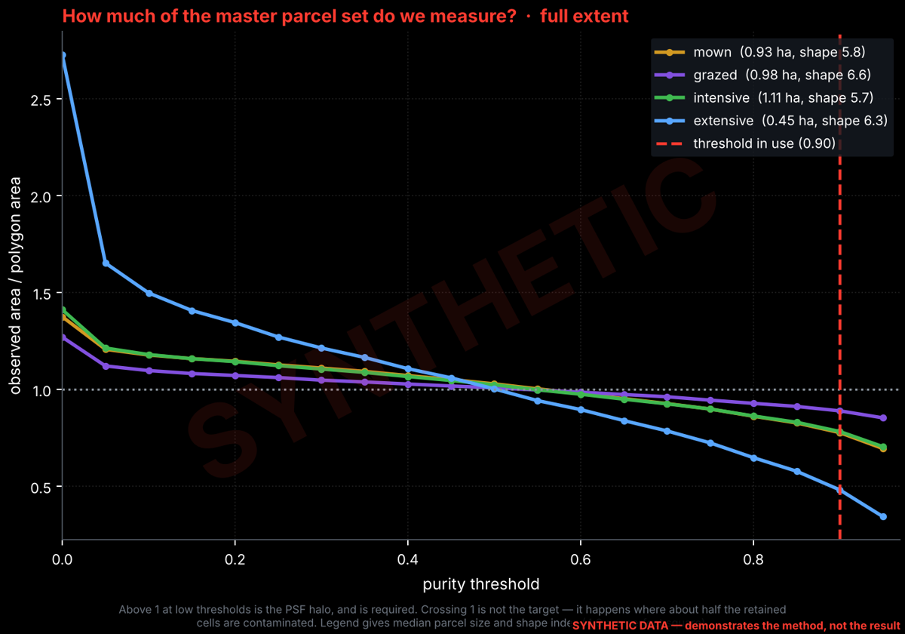
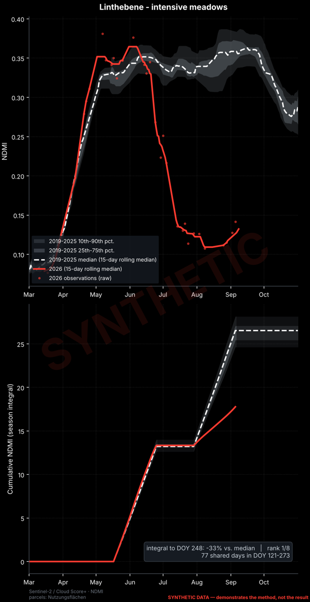
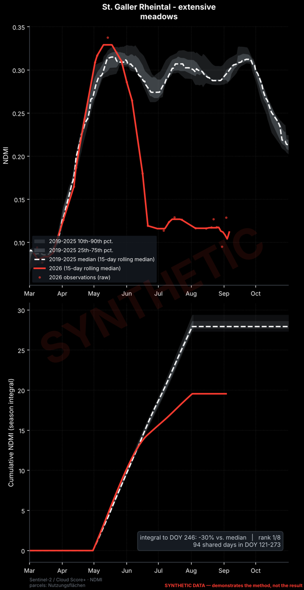
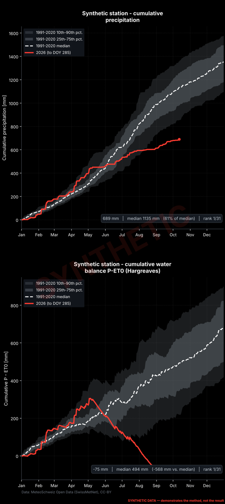
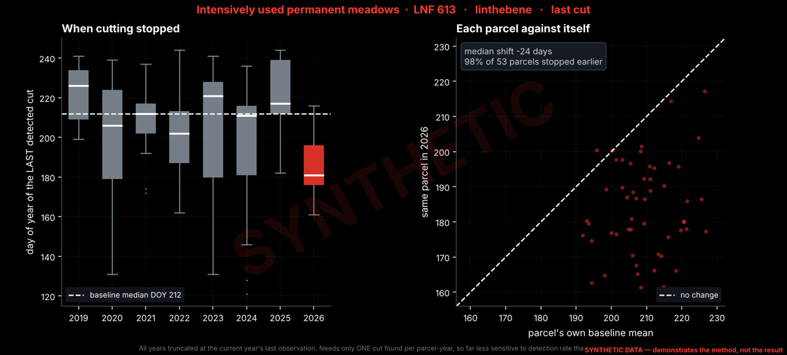

# Gallery

The figures, rendered, so the results can be read without cloning. There are
three kinds, and they are never mixed:

- **Real.** Results from the cantonal data, from the run named in each caption.
  These are aggregates only (curves, distributions, totals); no map, field
  outline or purity patch from the cantonal data is published.
- **Model.** Figures that use no data at all.
- **Synthetic.** Output of `make demo`, stamped SYNTHETIC. They show what each
  step of the method does, not what happened in 2026.

`make gallery` refreshes the model and synthetic figures. The real figures are
copied in by hand from a real run ([rules](https://github.com/floew2/drought-from-space-switzerland/blob/main/docs/figures/real/README.md)).

---

## Real results

### What it looked like

Sentinel-2 true colour, 10 m, 15 June – 31 July: the 2019–2025 median against
2026, with an identical stretch. Made with `gee/gee_s2_hotspots.js` for the
August 2026 presentation. Imagery only; no parcel data.

### Grassland condition, season NDMI against 2019–2025

Run of 14 October 2026. Mask built with the box ⊛ Gaussian response model and
no size filter ([METHOD §2](METHOD.md#2-the-grassland-mask)); integrals over
DOY 121–273.

| | intensive meadows | extensive meadows |
|---|---|---|
| **Linthebene** |  −27 %, rank 1 of 8 |  −29 %, rank 1 of 8 |
| **St. Galler Rheintal** |  −23 %, rank 1 of 8 |  −28 %, rank 1 of 8 |

Top panel: site-mean NDMI, with the 2019–2025 envelope and median, 2026 in red,
and the raw 2026 observations as dots. Bottom panel: the season integral over
the days every year observed (unshaded). [METHOD §3](METHOD.md#3-grassland-condition).

### Precipitation and water balance, St. Gallen

690 mm to 12 October, 61 % of the 1991–2020 median, the driest of 31 years.
P − ET0 (Hargreaves) stood at −74 mm, against a median of +494 mm.
Source: MeteoSwiss. [METHOD §4](METHOD.md#4-precipitation-and-water-balance).

### Field size and shape, and what the purity threshold costs

Distributions and totals over the master parcel set. No geometry is shown.
Built without the old 0.25 ha filter. [METHOD §2.2](METHOD.md#22-why-purity-matters-the-fields-are-small-and-mostly-edge),
[§2.4](METHOD.md#24-what-the-threshold-costs).

---

## Model

### The sensor response

The response the purity mask is built on: a 10 m detector box convolved with
Gaussian optics (σ 4.35 m), derived from the specified system MTF.
[METHOD §2.3](METHOD.md#23-the-sensor-response).

---

## Synthetic demo

Output of `make demo`, on synthetic data calibrated to the real distributions.
These figures demonstrate the method; they say nothing about 2026.

### Field size and shape

The synthetic parcels are drawn to the real medians, small-field shares and
shape indices, including the long tail above 10.
[METHOD §2.2](METHOD.md#22-why-purity-matters-the-fields-are-small-and-mostly-edge).

### What purity keeps

Above 1 at low thresholds is the response reaching past the field. That is
required, and the demo fails if it does not happen. Below 1 at high thresholds
is the edges being given up. [METHOD §2.4](METHOD.md#24-what-the-threshold-costs).

### Condition and precipitation, reproduced

These are calibrated: the synthetic 2026 collapse was solved so that the same
code returns the real integrals. Reproducing them shows the pipeline is wired
correctly. It is not a second result.

### When cutting stopped

The frozen detector run on synthetic field series with planted cuts, compared
to the end of the synthetic 2026 series. [METHOD §5](METHOD.md#5-cut-detection).
