# Gallery

The figures, rendered, so the results can be read without cloning. All of them
come from the real data, except the sensor-response model, which uses no data
at all. They are aggregates (curves, distributions, totals) and imagery. Two
exceptions show individual fields: the imagery-to-mask overview (field outlines
in three 500 m windows) and one meadow's mowing curve (no ID, no location). The
parcel data itself is not published.

Synthetic figures are never committed. `make demo` writes them to
`output/synthetic/figures/` for anyone who wants to see what each step does.
The real figures are copied in by hand from a real run
([rules](https://github.com/floew2/drought-from-space-switzerland/blob/main/docs/figures/real/README.md)).

---

## What it looked like

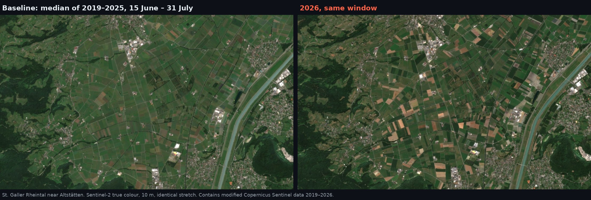

Sentinel-2 true colour, 10 m, 15 June – 31 July: the 2019–2025 median against
2026, with an identical stretch. Made in the Earth Engine Code Editor for the
August 2026 presentation. Imagery only; no parcel data.

## From imagery to mask

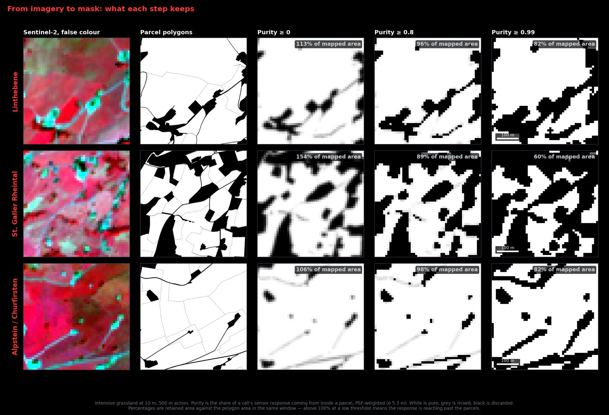

Intensive grassland at Linthebene, in the Rheintal and at Alpstein, 500 m
across. From left: Sentinel-2 false colour, the field outlines, and purity at
three thresholds (white pure, grey mixed, black discarded). The percentages are
retained area against field area: above 100 % at a low threshold, the response
reaches past the fields. From the August 2026 presentation, built with the
earlier single-Gaussian response (σ 5.3 m); `drought mask overview` redraws it
from the current mask.
[METHOD §2.4](METHOD.md#24-what-the-threshold-costs).

## Grassland condition, season NDMI against 2019–2025

Run of 14 October 2026. Mask built with the box ⊛ Gaussian response model and
no size filter ([METHOD §2](METHOD.md#2-the-grassland-mask)); integrals over
DOY 121–273.

| | intensive meadows | extensive meadows |
|---|---|---|
| **Linthebene** | 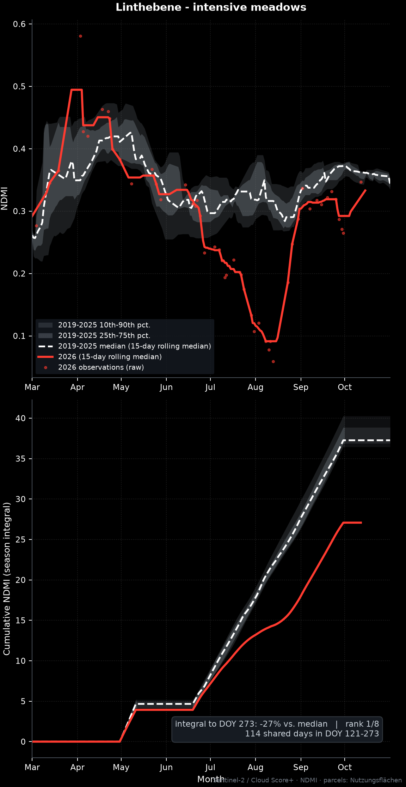 −27 %, rank 1 of 8 | 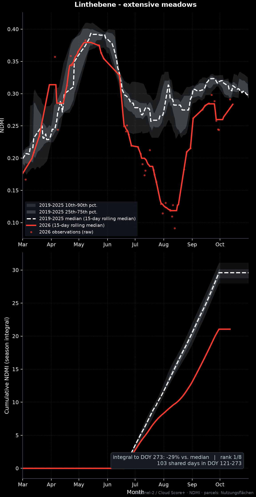 −29 %, rank 1 of 8 |
| **St. Galler Rheintal** | 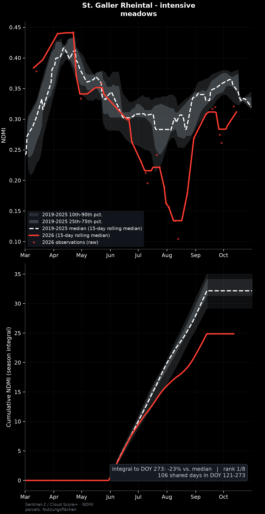 −23 %, rank 1 of 8 | 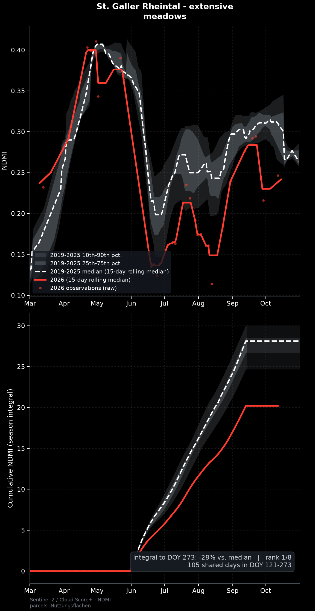 −28 %, rank 1 of 8 |

Top panel: site-mean NDMI, with the 2019–2025 envelope and median, 2026 in red,
and the raw 2026 observations as dots. Bottom panel: the season integral over
the days every year observed. [METHOD §3](METHOD.md#3-grassland-condition).

## You can watch the mowing stop

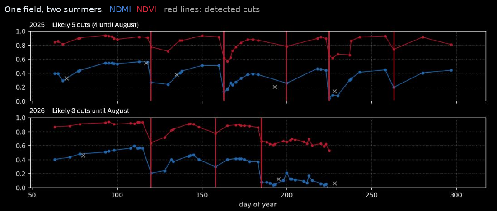

One meadow, two summers. Each sawtooth is a harvest: the grass is cut, the
index drops, then it regrows. In 2025 there are five cuts; in 2026, three, and
after the July cut the canopy no longer recovers. From the August 2026
presentation. [METHOD §5](METHOD.md#5-cut-detection).

## Precipitation and water balance, St. Gallen

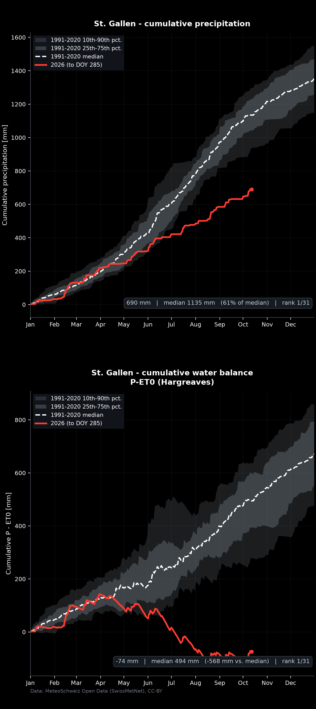

690 mm to 12 October, 61 % of the 1991–2020 median, the driest of 31 years.
P − ET0 (Hargreaves) stood at −74 mm, against a median of +494 mm.
Source: MeteoSwiss. [METHOD §4](METHOD.md#4-precipitation-and-water-balance).

## Field size and shape, and what the purity threshold costs

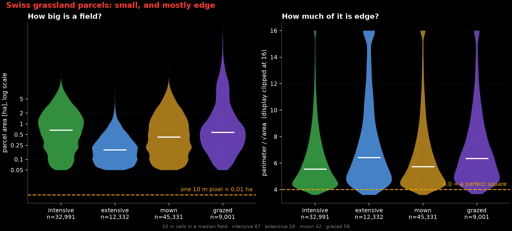

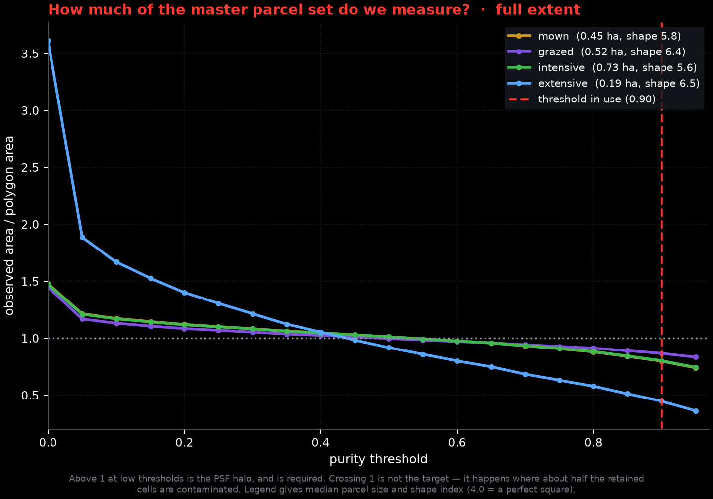

Distributions and totals over the master parcel set. No geometry is shown.
[METHOD §2.2](METHOD.md#22-why-purity-matters-the-fields-are-small-and-mostly-edge),
[§2.4](METHOD.md#24-what-the-threshold-costs).

## The sensor response (model)

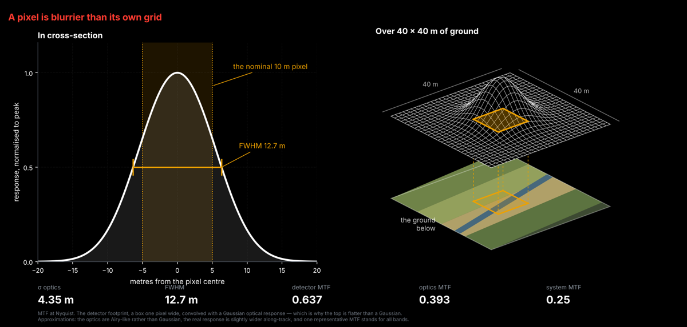

The response the purity mask is built on: a 10 m detector box convolved with
Gaussian optics (σ 4.35 m), from the system MTF.
[METHOD §2.3](METHOD.md#23-the-sensor-response).
